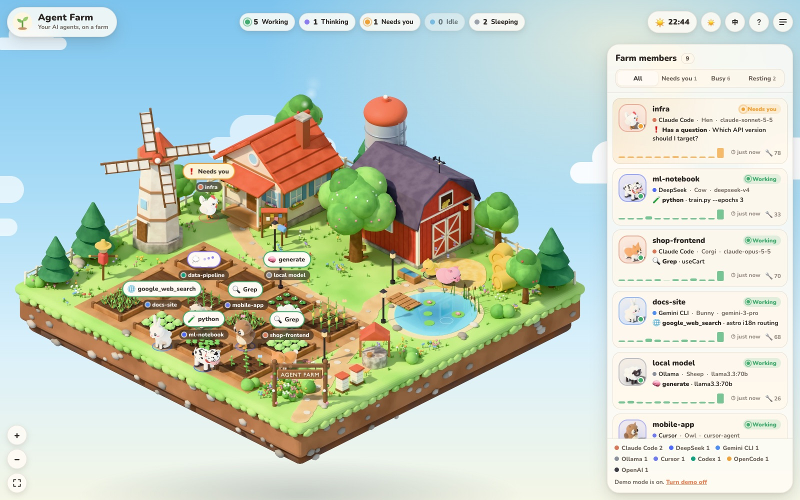

# 🌾 Agent Farm

[繁體中文](README.md) · **English**

A **Blender-rendered** 2.5D isometric farm where every AI agent on your computer is a farm animal. See at a glance who is working, who is thinking, and who is waiting for you.



- **Many platforms**: Claude Code, OpenAI Codex, Cursor, Gemini CLI, Google Antigravity, OpenCode and Ollama are detected automatically; anything else can join with one HTTP request.
- **One animal per agent**: fox, cat, rabbit, owl, cow, pig, sheep, hen, duck, corgi, goat and pony. A session keeps the same animal.
- **Nothing to install**: no `npm install`, no Blender; the art is pre-rendered and in the repo.
- **Stays on your machine**: it only reads local session logs and uploads nothing.
- Day/night, English/繁體中文, mobile layout, desktop notifications when an agent needs you.

## Download

| Build | Download |
| --- | --- |
| Apple Silicon (M-series) | [AgentFarm-1.1.3-macOS-AppleSilicon.dmg](https://github.com/irons163/agent-farm/releases/latest/download/AgentFarm-1.1.3-macOS-AppleSilicon.dmg) |
| Intel | [AgentFarm-1.1.3-macOS-Intel.dmg](https://github.com/irons163/agent-farm/releases/latest/download/AgentFarm-1.1.3-macOS-Intel.dmg) |
| Windows 10/11 (64-bit) | [AgentFarm-1.1.3-Windows-x64-setup.exe](https://github.com/irons163/agent-farm/releases/latest/download/AgentFarm-1.1.3-Windows-x64-setup.exe) |
| Linux (x64: `.AppImage` or `.deb`; arm64: `.AppImage`) | [latest release](https://github.com/irons163/agent-farm/releases/latest) |

Open the DMG, drag Agent Farm to Applications, done. No Node.js to install, no terminal to open.

The app runs the server in the background and opens a window. Close the window and it keeps running in the menu bar (top-right icon); you get a native notification when an agent needs your attention.

**Windows / Linux:** the same, with a tray icon instead of the menu bar. The Windows installer is not code-signed yet, so SmartScreen says "Windows protected your PC": click **More info → Run anyway**. On Linux, make the AppImage executable (`chmod +x`) or install the `.deb`. GNOME has no tray by default; install the AppIndicator extension to see the icon (without it, start the app again to bring the window back).

Or run from source:

## Quick start

Needs [Node.js](https://nodejs.org) 20 or newer (22.13+ to see OpenCode).

```bash
git clone https://github.com/irons163/agent-farm.git
cd agent-farm
npm start
```

Open <http://127.0.0.1:5180>. Agents you used in the last 12 hours show up on their own.

No agents running yet? Try the demo:

```bash
npm run demo
```

## What the animals mean

| Status | Animal |
| --- | --- |
| 🌱 Working | Tends its own plot; the more tools it uses, the bigger the crops grow |
| 💭 Thinking | Stands by its plot with a thought bubble |
| ❗ Needs you | Waits at the farmhouse porch (permission or a question) and notifies you |
| ⚠️ Error | Gets a little storm cloud |
| ✅ Idle | Strolls the meadow |
| 💤 Sleeping | After 15 idle minutes, naps by the barn |

The windmill and chimney smoke speed up with the number of busy agents. Up to 12 animals live on the farm; the rest are listed in the side panel. Scroll to zoom, drag to pan, click an animal to see what it did recently.

## Platforms

| Platform | Reads from (read-only) | Status |
| --- | --- | --- |
| Claude Code | `~/.claude/projects/` (or `CLAUDE_CONFIG_DIR`) | ✅ tested |
| OpenAI Codex (CLI / desktop) | `~/.codex/sessions/` (or `CODEX_HOME`) | ✅ tested |
| Cursor Agent | `~/.cursor/projects/*/agent-transcripts/` | ✅ tested |
| Google Antigravity | `~/.gemini/antigravity/` | ✅ tested |
| OpenCode | `~/.local/share/opencode/opencode.db` | ✅ tested |
| Gemini CLI | `~/.gemini/tmp/*/chats/` | ⚠️ built from the log format, not tested yet |
| Ollama | `http://127.0.0.1:11434/api/ps` (or `OLLAMA_HOST`) | ⚠️ not tested yet |
| Anything else | `POST /api/report`, see below | ✅ |

Developed and tested on macOS. Linux and Windows paths are handled but haven't been tried yet; issues welcome.

### Put any other AI on the farm

OpenAI Agents SDK, LangGraph, AutoGen, DeepSeek, your own bots… anything can report its status:

```bash
curl -X POST http://127.0.0.1:5180/api/report -H 'content-type: application/json' \
  -d '{"id":"support-bot","platform":"openai","status":"working","tool":"search","detail":"order #1932"}'
```

```bash
node bin/farm-report.mjs --id researcher --platform deepseek --status thinking
```

```python
import requests
requests.post("http://127.0.0.1:5180/api/report", json={
    "id": "researcher", "platform": "deepseek", "status": "working", "tool": "web_search"})
```

`status` is one of `working`, `thinking`, `waiting`, `error`, `idle`, `sleeping`, or `offline` to remove the agent. Optional fields: `name`, `model`, `project`, `task`, `detail`, `tokens`, `animal` (pick one), `color` (`#RRGGBB`).

### Claude Code live hooks (optional)

Status already comes from the transcripts. Hooks make states like "waiting for permission" instant and exact. The "?" dialog has a ready-to-paste block for `~/.claude/settings.json` with the right path filled in.

## Settings

| Flag | Env var | Default | What it does |
| --- | --- | --- | --- |
| `--port 5181` | `PORT` | `5180` | Port |
| `--demo` | `FARM_DEMO=on` | `off` | Show demo animals |
| `--host 0.0.0.0` | `HOST` | `127.0.0.1` | Open to other devices; needs a token, see Security |
| `--token …` | `FARM_TOKEN` | none | Access token |
| | `FARM_WINDOW_HOURS` | `12` | Hide sessions idle for longer than this |
| | `FARM_SLEEP_MIN` | `15` | Idle minutes before an animal goes to sleep |
| | `FARM_ONESHOT_MIN` | `30` | Minutes a finished one-shot session stays |
| | `FARM_COLLECTORS` | all | Only some platforms, e.g. `claude-code,codex` |

Put flags after `--`, e.g. `npm start -- --port 5181`; this works on Windows too.

**Temporary sessions**: sessions run from a temp folder (`/tmp`, `/var/folders`) or one-shots (one prompt, no tools) are tagged "Temp" and listed last, so they never take an animal or plot from a real agent. To hide them: "?" → Temporary sessions → Hide.

## Security and privacy

The farm shows prompt snippets, project paths and session IDs, so:

- It listens on `127.0.0.1` only and accepts only loopback host names (blocks DNS rebinding). Writes from a browser must come from the farm's own page, so other websites and other local pages can't change anything.
- Platform logs are only read, never written or uploaded. The only outside request is Google Fonts. The app does not check for updates by itself either: use “Check for updates” in the help panel or the tray menu to open the releases page.
- To watch from your phone or another computer, you must set a token or the server won't start:

  ```bash
  npm start -- --host 0.0.0.0 --token a-long-random-string
  ```

  Open `http://<this-computer's-IP>:5180/?token=<token>` once on each device; a cookie remembers it. `farm-report` and the Claude Code hook read the `FARM_TOKEN` env var. The token travels over plain HTTP, so only do this on a network you trust.

## Troubleshooting

- **`Port 5180 is already in use`**: the farm may already be running, or pick another port: `npm start -- --port 5181`.
- **My agent doesn't show up**: the "?" dialog lists which platforms were detected. Sessions idle for more than 12 hours are hidden.
- **OpenCode says it needs a newer Node**: reading OpenCode's database needs Node.js 22.13+.

## License

[MIT](LICENSE)
