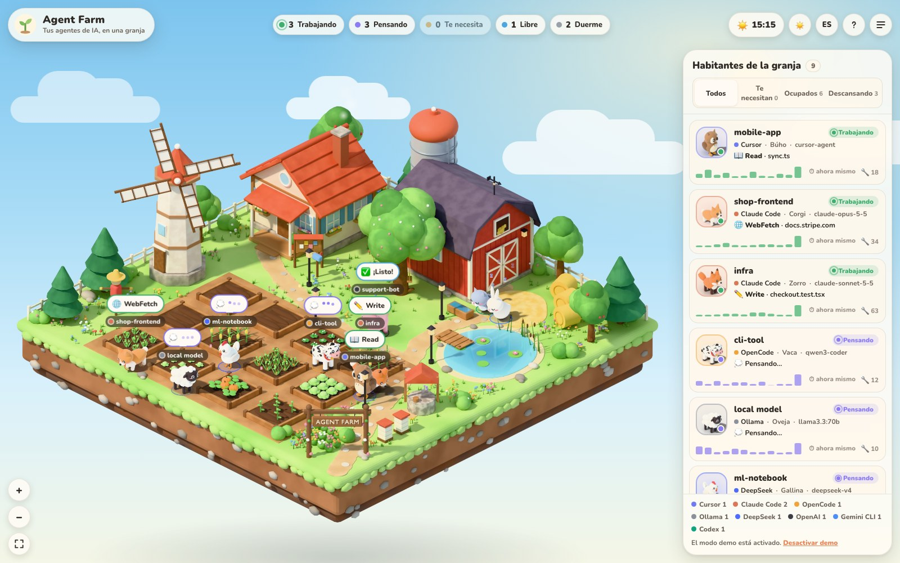
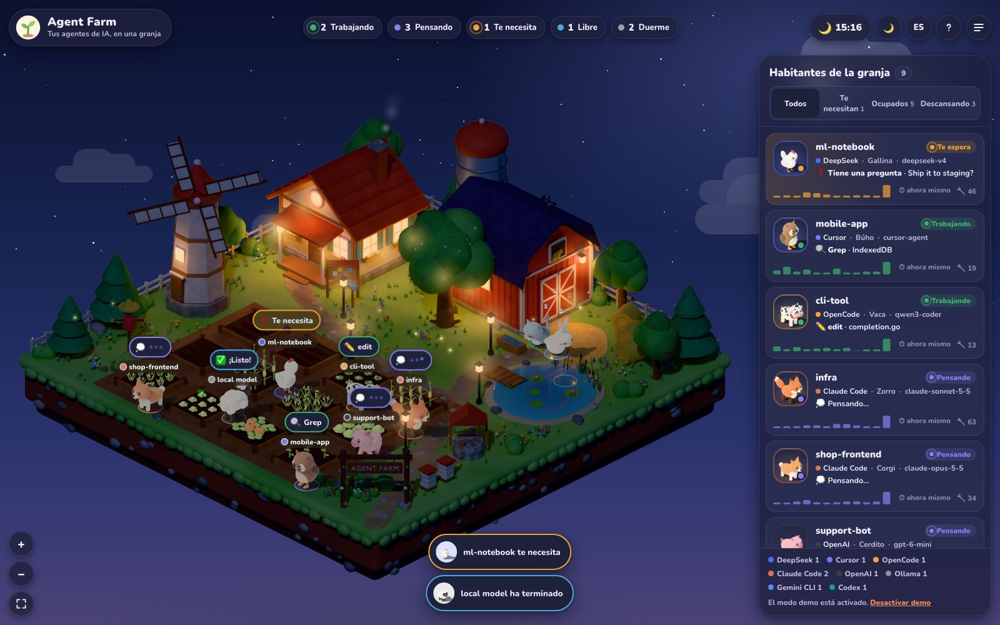

# 🌾 Agent Farm

[English](README.md) · [繁體中文](README.zh-TW.md) · [简体中文](README.zh-CN.md) · [Français](README.fr.md) · **Español** · [日本語](README.ja.md) · [한국어](README.ko.md)

Una granja isométrica 2.5D **renderizada con Blender** donde cada agente de IA de tu ordenador es un animal de la granja. Mira de un vistazo quién trabaja, quién piensa y quién te está esperando.



- **Muchas plataformas**: Claude Code, OpenAI Codex, Cursor, Gemini CLI, Google Antigravity, OpenCode y Ollama se detectan automáticamente; cualquier otra puede unirse con una sola petición HTTP.
- **Un animal por agente**: zorro, gato, conejo, búho, vaca, cerdo, oveja, gallina, pato, corgi, cabra y poni. Una sesión conserva siempre el mismo animal.
- **Nada que instalar**: ni `npm install` ni Blender; las ilustraciones ya están renderizadas y incluidas en el repositorio.
- **Se queda en tu máquina**: solo lee los registros de sesión locales y no sube nada.
- Día/noche, 30 idiomas (sigue el idioma de tu sistema), diseño móvil y notificaciones de escritorio cuando un agente te necesita.

## Descarga

| Versión | Descarga |
| --- | --- |
| Apple Silicon (serie M) | [AgentFarm-1.1.3-macOS-AppleSilicon.dmg](https://github.com/irons163/agent-farm/releases/latest/download/AgentFarm-1.1.3-macOS-AppleSilicon.dmg) |
| Intel | [AgentFarm-1.1.3-macOS-Intel.dmg](https://github.com/irons163/agent-farm/releases/latest/download/AgentFarm-1.1.3-macOS-Intel.dmg) |
| Windows 10/11 (64 bits) | [AgentFarm-1.1.3-Windows-x64-setup.exe](https://github.com/irons163/agent-farm/releases/latest/download/AgentFarm-1.1.3-Windows-x64-setup.exe) |
| Linux (x64: `.AppImage` o `.deb`; arm64: `.AppImage`) | [última versión](https://github.com/irons163/agent-farm/releases/latest) |

Abre el DMG, arrastra Agent Farm a Aplicaciones y listo. Sin instalar Node.js ni abrir el terminal.

La app ejecuta el servidor en segundo plano y abre una ventana. Si cierras la ventana, sigue funcionando en la barra de menús (icono de arriba a la derecha); recibes una notificación nativa cuando un agente necesita tu atención.

**Windows / Linux:** igual, pero con un icono en la bandeja del sistema en lugar de la barra de menús. El instalador de Windows todavía no está firmado, así que SmartScreen muestra «Windows protegió su PC»: haz clic en **Más información → Ejecutar de todos modos**. En Linux, da permisos de ejecución al AppImage (`chmod +x`) o instala el `.deb`. GNOME no tiene bandeja por defecto; instala la extensión AppIndicator para ver el icono (sin ella, vuelve a abrir la app para recuperar la ventana).

O ejecútala desde el código fuente:

## Inicio rápido

Requiere [Node.js](https://nodejs.org) 20 o superior (22.13+ para ver OpenCode).

```bash
git clone https://github.com/irons163/agent-farm.git
cd agent-farm
npm start
```

Abre <http://127.0.0.1:5180>. Los agentes que hayas usado en las últimas 12 horas aparecen solos.

¿Aún no tienes agentes en marcha? Prueba la demo:

```bash
npm run demo
```

## Qué significan los animales

| Estado | Animal |
| --- | --- |
| 🌱 Trabajando | Cuida su propia parcela; cuantas más herramientas usa, más crecen los cultivos |
| 💭 Pensando | Está junto a su parcela con una burbuja de pensamiento |
| ❗ Te necesita | Espera en el porche de la casa (permiso o pregunta) y te avisa |
| ⚠️ Error | Le sale una pequeña nube de tormenta |
| ✅ Libre | Pasea por la pradera |
| 💤 Durmiendo | Tras 15 minutos de inactividad, echa la siesta junto al establo |

El molino y el humo de la chimenea van más rápido cuantos más agentes estén ocupados. En la granja caben hasta 12 animales; el resto aparece en el panel lateral. Rueda para hacer zoom, arrastra para mover y haz clic en un animal para ver lo que ha hecho últimamente.



## Plataformas

| Plataforma | De dónde lee (solo lectura) | Estado |
| --- | --- | --- |
| Claude Code | `~/.claude/projects/` (o `CLAUDE_CONFIG_DIR`) | ✅ probado |
| OpenAI Codex (CLI / escritorio) | `~/.codex/sessions/` (o `CODEX_HOME`) | ✅ probado |
| Cursor Agent | `~/.cursor/projects/*/agent-transcripts/` | ✅ probado |
| Google Antigravity | `~/.gemini/antigravity/` | ✅ probado |
| OpenCode | `~/.local/share/opencode/opencode.db` | ✅ probado |
| Gemini CLI | `~/.gemini/tmp/*/chats/` | ⚠️ hecho según el formato de los registros, aún sin probar |
| Ollama | `http://127.0.0.1:11434/api/ps` (o `OLLAMA_HOST`) | ⚠️ aún sin probar |
| Cualquier otra | `POST /api/report`, ver abajo | ✅ |

Desarrollado y probado en macOS. Las rutas de Linux y Windows están contempladas pero aún no se han probado; las issues son bienvenidas.

### Pon a cualquier otra IA en la granja

OpenAI Agents SDK, LangGraph, AutoGen, DeepSeek, tus propios bots… cualquiera puede informar de su estado:

```bash
curl -X POST http://127.0.0.1:5180/api/report -H 'content-type: application/json' \
  -d '{"id":"support-bot","platform":"openai","status":"working","tool":"search","detail":"order #1932"}'
```

```bash
node bin/farm-report.mjs --id researcher --platform deepseek --status thinking
```

```python
import requests
requests.post("http://127.0.0.1:5180/api/report", json={
    "id": "researcher", "platform": "deepseek", "status": "working", "tool": "web_search"})
```

`status` es uno de `working`, `thinking`, `waiting`, `error`, `idle`, `sleeping`, u `offline` para quitar al agente. Campos opcionales: `name`, `model`, `project`, `task`, `detail`, `tokens`, `animal` (elegir uno), `color` (`#RRGGBB`).

### Hooks en vivo de Claude Code (opcional)

El estado ya se deduce de las transcripciones. Los hooks hacen que estados como «esperando permiso» sean instantáneos y exactos. El diálogo «?» incluye un bloque listo para pegar en `~/.claude/settings.json` con la ruta correcta ya rellenada.

## Ajustes

| Opción | Variable de entorno | Valor por defecto | Qué hace |
| --- | --- | --- | --- |
| `--port 5181` | `PORT` | `5180` | Puerto |
| `--demo` | `FARM_DEMO=on` | `off` | Mostrar animales de demostración |
| `--host 0.0.0.0` | `HOST` | `127.0.0.1` | Abrir a otros dispositivos; requiere un token, ver Seguridad |
| `--token …` | `FARM_TOKEN` | ninguno | Token de acceso |
| | `FARM_WINDOW_HOURS` | `12` | Ocultar sesiones inactivas durante más tiempo que este |
| | `FARM_SLEEP_MIN` | `15` | Minutos de inactividad antes de que un animal se vaya a dormir |
| | `FARM_ONESHOT_MIN` | `30` | Minutos que permanece una sesión puntual ya terminada |
| | `FARM_COLLECTORS` | todas | Solo algunas plataformas, p. ej. `claude-code,codex` |

Pon las opciones después de `--`, p. ej. `npm start -- --port 5181`; también funciona en Windows.

**Sesiones temporales**: las sesiones ejecutadas desde una carpeta temporal (`/tmp`, `/var/folders`) o puntuales (una pregunta, sin herramientas) se marcan como «Temp.» y se listan al final, de modo que nunca quitan el animal ni la parcela a un agente real. Para ocultarlas: «?» → Sesiones temporales → Ocultar.

## Seguridad y privacidad

La granja muestra fragmentos de prompts, rutas de proyectos e ID de sesión, así que:

- Solo escucha en `127.0.0.1` y solo acepta nombres de host de bucle local (bloquea el DNS rebinding). Las escrituras desde un navegador deben venir de la propia página de la granja, así que otros sitios web y otras páginas locales no pueden cambiar nada.
- Los registros de las plataformas solo se leen, nunca se escriben ni se suben. La única petición externa es a Google Fonts. La app tampoco busca actualizaciones por sí sola: usa «Buscar actualizaciones» en el panel de ayuda o en el menú de la bandeja para abrir la página de versiones.
- Para verla desde el móvil u otro ordenador, debes definir un token o el servidor no arrancará:

  ```bash
  npm start -- --host 0.0.0.0 --token una-cadena-aleatoria-larga
  ```

  Abre una vez `http://<IP-de-este-ordenador>:5180/?token=<token>` en cada dispositivo; una cookie lo recuerda. `farm-report` y el hook de Claude Code leen la variable de entorno `FARM_TOKEN`. El token viaja por HTTP sin cifrar, así que hazlo solo en una red de confianza.

## Solución de problemas

- **`Port 5180 is already in use`**: puede que la granja ya esté en marcha, o elige otro puerto: `npm start -- --port 5181`.
- **Mi agente no aparece**: el diálogo «?» indica qué plataformas se detectaron. Las sesiones inactivas durante más de 12 horas se ocultan.
- **OpenCode dice que necesita un Node más reciente**: leer la base de datos de OpenCode requiere Node.js 22.13+.

## Licencia

[MIT](LICENSE)
