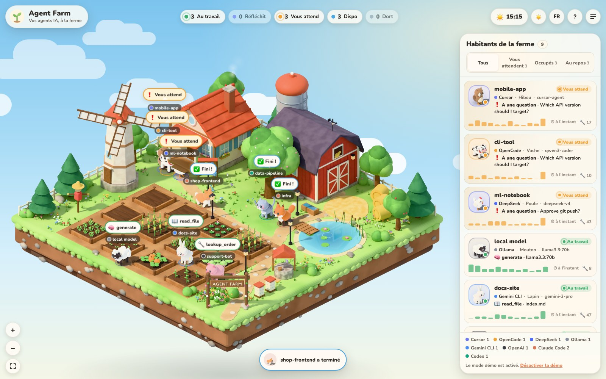
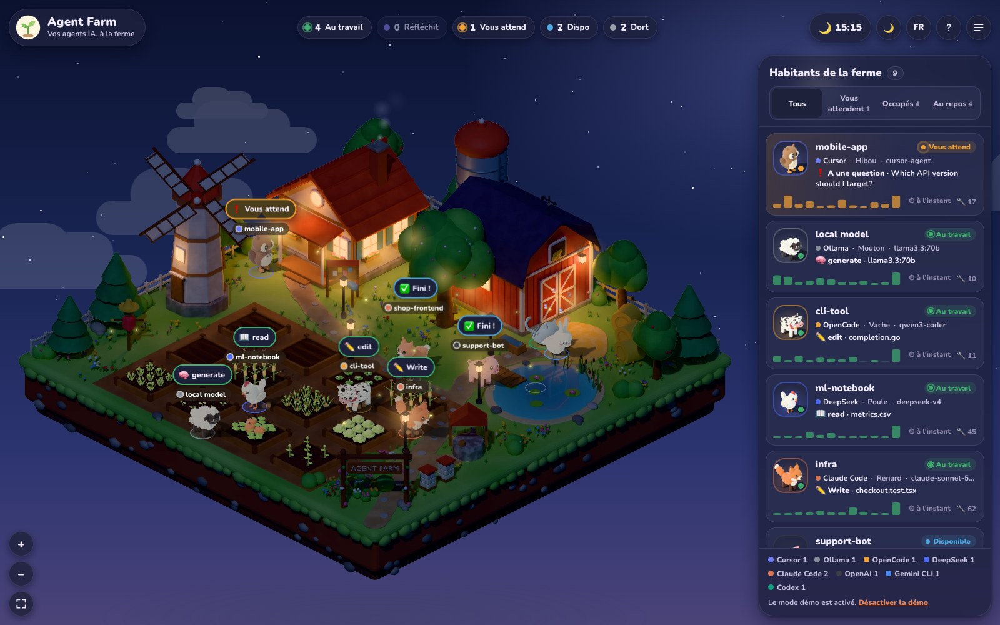

# 🌾 Agent Farm

[English](README.md) · [繁體中文](README.zh-TW.md) · [简体中文](README.zh-CN.md) · **Français** · [Español](README.es.md) · [日本語](README.ja.md) · [한국어](README.ko.md)

Une ferme isométrique 2.5D **rendue avec Blender** où chaque agent IA de votre ordinateur est un animal de la ferme. Voyez d’un coup d’œil qui travaille, qui réfléchit et qui vous attend.



- **Nombreuses plateformes** : Claude Code, OpenAI Codex, Cursor, Gemini CLI, Google Antigravity, OpenCode et Ollama sont détectés automatiquement ; tout le reste peut les rejoindre avec une simple requête HTTP.
- **Un animal par agent** : renard, chat, lapin, hibou, vache, cochon, mouton, poule, canard, corgi, chèvre et poney. Une session garde toujours le même animal.
- **Rien à installer** : ni `npm install`, ni Blender ; les illustrations sont déjà rendues et incluses dans le dépôt.
- **Reste sur votre machine** : il ne lit que les journaux de session locaux et n’envoie rien.
- Jour/nuit, 30 langues (suit la langue de votre système), affichage mobile, notifications de bureau quand un agent a besoin de vous.

## Téléchargement

| Version | Téléchargement |
| --- | --- |
| Apple Silicon (série M) | [AgentFarm-1.1.3-macOS-AppleSilicon.dmg](https://github.com/irons163/agent-farm/releases/latest/download/AgentFarm-1.1.3-macOS-AppleSilicon.dmg) |
| Intel | [AgentFarm-1.1.3-macOS-Intel.dmg](https://github.com/irons163/agent-farm/releases/latest/download/AgentFarm-1.1.3-macOS-Intel.dmg) |
| Windows 10/11 (64 bits) | [AgentFarm-1.1.3-Windows-x64-setup.exe](https://github.com/irons163/agent-farm/releases/latest/download/AgentFarm-1.1.3-Windows-x64-setup.exe) |
| Linux (x64 : `.AppImage` ou `.deb` ; arm64 : `.AppImage`) | [dernière version](https://github.com/irons163/agent-farm/releases/latest) |

Ouvrez le DMG, glissez Agent Farm dans Applications, c’est tout. Pas de Node.js à installer, pas de terminal à ouvrir.

L’app lance le serveur en arrière-plan et ouvre une fenêtre. Si vous fermez la fenêtre, elle continue de tourner dans la barre des menus (icône en haut à droite) ; vous recevez une notification native quand un agent a besoin de vous.

**Windows / Linux :** même principe, avec une icône dans la zone de notification au lieu de la barre des menus. Le programme d’installation Windows n’est pas encore signé : SmartScreen affiche « Windows a protégé votre PC », cliquez sur **Informations complémentaires → Exécuter quand même**. Sous Linux, rendez l’AppImage exécutable (`chmod +x`) ou installez le `.deb`. GNOME n’a pas de zone de notification par défaut ; installez l’extension AppIndicator pour voir l’icône (sans elle, relancez l’app pour faire revenir la fenêtre).

Ou lancez-la depuis les sources :

## Démarrage rapide

Nécessite [Node.js](https://nodejs.org) 20 ou plus récent (22.13+ pour voir OpenCode).

```bash
git clone https://github.com/irons163/agent-farm.git
cd agent-farm
npm start
```

Ouvrez <http://127.0.0.1:5180>. Les agents utilisés au cours des 12 dernières heures apparaissent d’eux-mêmes.

Aucun agent en cours pour l’instant ? Essayez la démo :

```bash
npm run demo
```

## Ce que font les animaux

| Statut | Animal |
| --- | --- |
| 🌱 Au travail | S’occupe de sa parcelle ; plus il utilise d’outils, plus les cultures grandissent |
| 💭 Réfléchit | Se tient près de sa parcelle avec une bulle de pensée |
| ❗ Vous attend | Attend au porche de la ferme (autorisation ou question) et vous notifie |
| ⚠️ Erreur | Reçoit un petit nuage d’orage |
| ✅ Disponible | Se promène dans le pré |
| 💤 Dort | Après 15 minutes d’inactivité, fait la sieste près de la grange |

Le moulin et la fumée de la cheminée s’accélèrent avec le nombre d’agents occupés. La ferme accueille jusqu’à 12 animaux ; les autres sont listés dans le panneau latéral. Molette pour zoomer, glisser pour déplacer, cliquez sur un animal pour voir ce qu’il a fait récemment.



## Plateformes

| Plateforme | Source (lecture seule) | Statut |
| --- | --- | --- |
| Claude Code | `~/.claude/projects/` (ou `CLAUDE_CONFIG_DIR`) | ✅ testé |
| OpenAI Codex (CLI / bureau) | `~/.codex/sessions/` (ou `CODEX_HOME`) | ✅ testé |
| Cursor Agent | `~/.cursor/projects/*/agent-transcripts/` | ✅ testé |
| Google Antigravity | `~/.gemini/antigravity/` | ✅ testé |
| OpenCode | `~/.local/share/opencode/opencode.db` | ✅ testé |
| Gemini CLI | `~/.gemini/tmp/*/chats/` | ⚠️ écrit d’après le format des journaux, pas encore testé |
| Ollama | `http://127.0.0.1:11434/api/ps` (ou `OLLAMA_HOST`) | ⚠️ pas encore testé |
| Tout le reste | `POST /api/report`, voir ci-dessous | ✅ |

Développé et testé sous macOS. Les chemins Linux et Windows sont gérés mais n’ont pas encore été essayés ; les issues sont les bienvenues.

### Mettre n’importe quelle autre IA à la ferme

OpenAI Agents SDK, LangGraph, AutoGen, DeepSeek, vos propres bots… tout peut signaler son état :

```bash
curl -X POST http://127.0.0.1:5180/api/report -H 'content-type: application/json' \
  -d '{"id":"support-bot","platform":"openai","status":"working","tool":"search","detail":"order #1932"}'
```

```bash
node bin/farm-report.mjs --id researcher --platform deepseek --status thinking
```

```python
import requests
requests.post("http://127.0.0.1:5180/api/report", json={
    "id": "researcher", "platform": "deepseek", "status": "working", "tool": "web_search"})
```

`status` vaut `working`, `thinking`, `waiting`, `error`, `idle`, `sleeping`, ou `offline` pour retirer l’agent. Champs facultatifs : `name`, `model`, `project`, `task`, `detail`, `tokens`, `animal` (au choix), `color` (`#RRGGBB`).

### Hooks en direct pour Claude Code (facultatif)

Le statut est déjà déduit des transcriptions. Les hooks rendent des états comme « en attente d’autorisation » instantanés et exacts. La boîte de dialogue « ? » contient un bloc prêt à coller dans `~/.claude/settings.json`, avec le bon chemin déjà rempli.

## Réglages

| Option | Variable d’env. | Défaut | Rôle |
| --- | --- | --- | --- |
| `--port 5181` | `PORT` | `5180` | Port |
| `--demo` | `FARM_DEMO=on` | `off` | Afficher les animaux de démonstration |
| `--host 0.0.0.0` | `HOST` | `127.0.0.1` | Ouvrir aux autres appareils ; nécessite un jeton, voir Sécurité |
| `--token …` | `FARM_TOKEN` | aucun | Jeton d’accès |
| | `FARM_WINDOW_HOURS` | `12` | Masquer les sessions inactives depuis plus longtemps que cela |
| | `FARM_SLEEP_MIN` | `15` | Minutes d’inactivité avant qu’un animal n’aille dormir |
| | `FARM_ONESHOT_MIN` | `30` | Minutes pendant lesquelles une session éphémère terminée reste affichée |
| | `FARM_COLLECTORS` | toutes | Seulement certaines plateformes, p. ex. `claude-code,codex` |

Placez les options après `--`, p. ex. `npm start -- --port 5181` ; cela fonctionne aussi sous Windows.

**Sessions temporaires** : les sessions lancées depuis un dossier temporaire (`/tmp`, `/var/folders`) ou éphémères (une seule question, aucun outil) sont marquées « Temp. » et placées en dernier, de sorte qu’elles ne prennent jamais l’animal ni la parcelle d’un vrai agent. Pour les masquer : « ? » → Sessions temporaires → Masquer.

## Sécurité et confidentialité

La ferme affiche des extraits de prompts, des chemins de projets et des identifiants de session, donc :

- Elle n’écoute que sur `127.0.0.1` et n’accepte que des noms d’hôte de bouclage (protège du DNS rebinding). Les écritures venant d’un navigateur doivent provenir de la page de la ferme elle-même : d’autres sites ou d’autres pages locales ne peuvent rien modifier.
- Les journaux des plateformes sont uniquement lus, jamais écrits ni envoyés. La seule requête externe est Google Fonts. L’app ne cherche pas non plus de mises à jour d’elle-même : utilisez « Rechercher des mises à jour » dans le panneau d’aide ou le menu de la zone de notification pour ouvrir la page des versions.
- Pour la voir depuis votre téléphone ou un autre ordinateur, vous devez définir un jeton, sinon le serveur ne démarre pas :

  ```bash
  npm start -- --host 0.0.0.0 --token une-longue-chaine-aleatoire
  ```

  Ouvrez une fois `http://<IP-de-cet-ordinateur>:5180/?token=<jeton>` sur chaque appareil ; un cookie s’en souvient. `farm-report` et le hook Claude Code lisent la variable d’environnement `FARM_TOKEN`. Le jeton circule en HTTP non chiffré : ne le faites que sur un réseau de confiance.

## Dépannage

- **`Port 5180 is already in use`** : la ferme tourne peut-être déjà, ou choisissez un autre port : `npm start -- --port 5181`.
- **Mon agent n’apparaît pas** : la boîte de dialogue « ? » indique quelles plateformes ont été détectées. Les sessions inactives depuis plus de 12 heures sont masquées.
- **OpenCode demande un Node plus récent** : la lecture de la base de données d’OpenCode nécessite Node.js 22.13+.

## Licence

[MIT](LICENSE)
