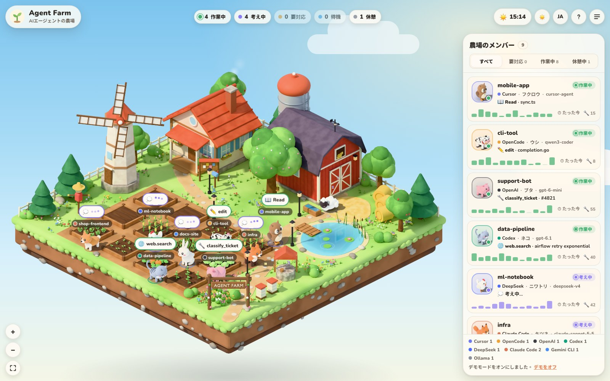
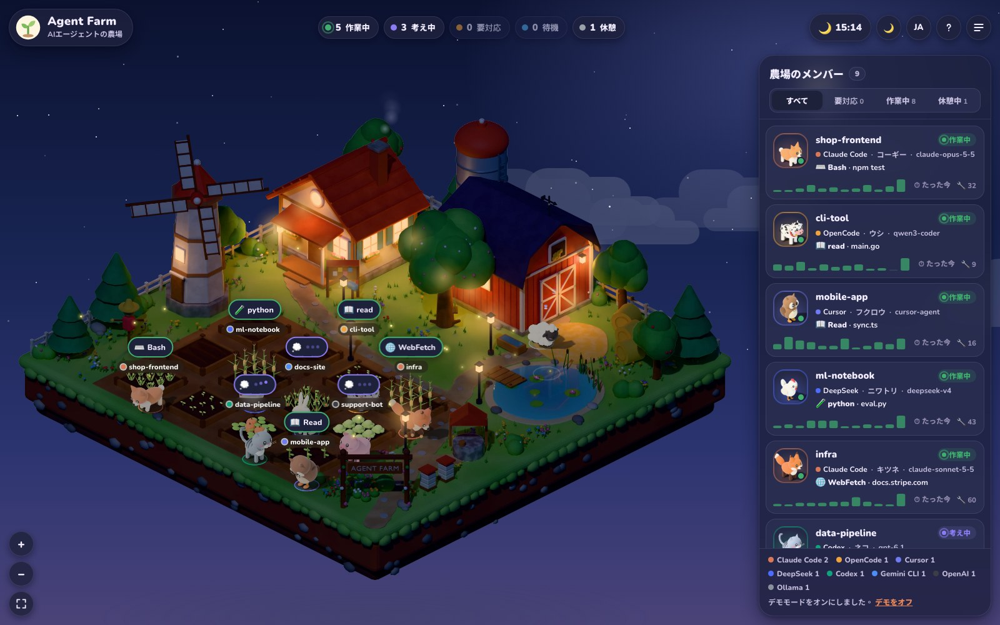

# 🌾 Agent Farm

[English](README.md) · [繁體中文](README.zh-TW.md) · [简体中文](README.zh-CN.md) · [Français](README.fr.md) · [Español](README.es.md) · **日本語** · [한국어](README.ko.md)

**Blender でレンダリングした** 2.5D アイソメトリックの農場です。パソコン上のすべての AI エージェントが農場の動物になります。誰が作業中で、誰が考え中で、誰があなたの返事を待っているのかが、ひと目でわかります。



- **多くのプラットフォームに対応**：Claude Code、OpenAI Codex、Cursor、Gemini CLI、Google Antigravity、OpenCode、Ollama は自動で検出されます。それ以外も HTTP リクエスト 1 回で参加できます。
- **エージェントごとに 1 匹の動物**：キツネ、ネコ、ウサギ、フクロウ、ウシ、ブタ、ヒツジ、ニワトリ、アヒル、コーギー、ヤギ、ポニー。同じセッションはいつも同じ動物です。
- **インストール不要**：`npm install` も Blender も要りません。画像はレンダリング済みでリポジトリに入っています。
- **あなたのマシンの中だけで動作**：ローカルのセッション履歴を読み取るだけで、何もアップロードしません。
- 昼／夜、30 言語（システムの言語に自動で合わせます）、モバイル表示、エージェントがあなたを必要としたときのデスクトップ通知。

## ダウンロード

| ビルド | ダウンロード |
| --- | --- |
| Apple Silicon（M シリーズ） | [AgentFarm-1.1.3-macOS-AppleSilicon.dmg](https://github.com/irons163/agent-farm/releases/latest/download/AgentFarm-1.1.3-macOS-AppleSilicon.dmg) |
| Intel | [AgentFarm-1.1.3-macOS-Intel.dmg](https://github.com/irons163/agent-farm/releases/latest/download/AgentFarm-1.1.3-macOS-Intel.dmg) |
| Windows 10/11（64 ビット） | [AgentFarm-1.1.3-Windows-x64-setup.exe](https://github.com/irons163/agent-farm/releases/latest/download/AgentFarm-1.1.3-Windows-x64-setup.exe) |
| Linux（x64：`.AppImage` または `.deb`、arm64：`.AppImage`） | [最新リリース](https://github.com/irons163/agent-farm/releases/latest) |

DMG を開いて Agent Farm を「アプリケーション」にドラッグするだけです。Node.js のインストールも、ターミナルを開く必要もありません。

アプリはバックグラウンドでサーバーを動かし、ウインドウを開きます。ウインドウを閉じてもメニューバー（右上のアイコン）で動き続け、エージェントがあなたの対応を必要とするとネイティブ通知が届きます。

**Windows / Linux：** 同じように使えます。メニューバーの代わりにシステムトレイにアイコンが出ます。Windows のインストーラーはまだコード署名されていないため、SmartScreen に「Windows によって PC が保護されました」と表示されます。**詳細情報 → 実行** をクリックしてください。Linux では AppImage に実行権限（`chmod +x`）を付けるか、`.deb` をインストールしてください。GNOME には標準でトレイがないため、アイコンを表示するには AppIndicator 拡張機能が必要です（なくても、アプリをもう一度起動すればウインドウが戻ります）。

ソースから実行することもできます：

## クイックスタート

[Node.js](https://nodejs.org) 20 以上が必要です（OpenCode を表示するには 22.13 以上）。

```bash
git clone https://github.com/irons163/agent-farm.git
cd agent-farm
npm start
```

<http://127.0.0.1:5180> を開いてください。直近 12 時間に使ったエージェントが自動で表示されます。

まだエージェントが動いていませんか？ デモを試せます：

```bash
npm run demo
```

## 動物たちの意味

| 状態 | 動物 |
| --- | --- |
| 🌱 作業中 | 自分の畑の世話をします。ツールを使うほど作物が大きくなります |
| 💭 考え中 | 吹き出しを浮かべて畑のそばに立っています |
| ❗ 要対応 | 農家の玄関で待ち（許可や質問）、通知を送ります |
| ⚠️ エラー | 小さな雨雲が現れます |
| ✅ 待機 | 草地をお散歩します |
| 💤 休憩 | 15 分間アイドル状態が続くと、納屋のそばで昼寝します |

風車と煙突の煙は、忙しいエージェントの数に応じて速くなります。農場に出られる動物は最大 12 匹で、残りはサイドパネルに一覧表示されます。スクロールでズーム、ドラッグで移動、動物をクリックすると最近の行動が見られます。



## 対応プラットフォーム

| プラットフォーム | 読み取り元（読み取り専用） | 状況 |
| --- | --- | --- |
| Claude Code | `~/.claude/projects/`（または `CLAUDE_CONFIG_DIR`） | ✅ 動作確認済み |
| OpenAI Codex（CLI／デスクトップ） | `~/.codex/sessions/`（または `CODEX_HOME`） | ✅ 動作確認済み |
| Cursor Agent | `~/.cursor/projects/*/agent-transcripts/` | ✅ 動作確認済み |
| Google Antigravity | `~/.gemini/antigravity/` | ✅ 動作確認済み |
| OpenCode | `~/.local/share/opencode/opencode.db` | ✅ 動作確認済み |
| Gemini CLI | `~/.gemini/tmp/*/chats/` | ⚠️ ログ形式に基づいて実装、未確認 |
| Ollama | `http://127.0.0.1:11434/api/ps`（または `OLLAMA_HOST`） | ⚠️ 未確認 |
| その他すべて | `POST /api/report`（下記参照） | ✅ |

開発と動作確認は macOS で行っています。Linux と Windows のパスにも対応していますが、まだ試せていません。Issue をお待ちしています。

### ほかの AI も農場に呼ぶ

OpenAI Agents SDK、LangGraph、AutoGen、DeepSeek、自作のボット……どんなものでも状態を報告できます：

```bash
curl -X POST http://127.0.0.1:5180/api/report -H 'content-type: application/json' \
  -d '{"id":"support-bot","platform":"openai","status":"working","tool":"search","detail":"order #1932"}'
```

```bash
node bin/farm-report.mjs --id researcher --platform deepseek --status thinking
```

```python
import requests
requests.post("http://127.0.0.1:5180/api/report", json={
    "id": "researcher", "platform": "deepseek", "status": "working", "tool": "web_search"})
```

`status` は `working`、`thinking`、`waiting`、`error`、`idle`、`sleeping` のいずれか、またはエージェントを退場させる `offline` です。任意の項目：`name`、`model`、`project`、`task`、`detail`、`tokens`、`animal`（動物を指定）、`color`（`#RRGGBB`）。

### Claude Code のリアルタイムフック（任意）

状態はすでに会話の履歴から判定されています。フックを追加すると、「許可待ち」のような状態が即座に正確に表示されます。「?」ダイアログには、正しいパスが入力済みの `~/.claude/settings.json` 用ブロックがあり、そのまま貼り付けられます。

## 設定

| フラグ | 環境変数 | 既定値 | 内容 |
| --- | --- | --- | --- |
| `--port 5181` | `PORT` | `5180` | ポート |
| `--demo` | `FARM_DEMO=on` | `off` | デモ用の動物を表示 |
| `--host 0.0.0.0` | `HOST` | `127.0.0.1` | 他のデバイスに公開（トークンが必要。セキュリティの項を参照） |
| `--token …` | `FARM_TOKEN` | なし | アクセストークン |
| | `FARM_WINDOW_HOURS` | `12` | これより長く動きのないセッションを非表示にする |
| | `FARM_SLEEP_MIN` | `15` | 動物が眠るまでのアイドル時間（分） |
| | `FARM_ONESHOT_MIN` | `30` | 終了した単発セッションが残る時間（分） |
| | `FARM_COLLECTORS` | すべて | 一部のプラットフォームのみ。例：`claude-code,codex` |

フラグは `--` の後ろに付けます。例：`npm start -- --port 5181`（Windows でも使えます）。

**一時セッション**：一時フォルダ（`/tmp`、`/var/folders`）から実行されたセッションや、単発のセッション（1 回質問しただけでツールを使わないもの）には「一時」と表示して最後に並べ、本物のエージェントの動物や畑を奪わないようにしています。非表示にするには、「?」→ 一時セッション → 非表示。

## セキュリティとプライバシー

農場にはプロンプトの断片、プロジェクトのパス、セッション ID が表示されるため、次のようにしています：

- `127.0.0.1` だけで待ち受け、ループバックのホスト名しか受け付けません（DNS リバインディング対策）。ブラウザからの書き込みは農場自身のページからのものに限られるため、他のウェブサイトやローカルの他のページからは何も変更できません。
- 各プラットフォームのログは読み取るだけで、書き込みもアップロードも行いません。外部へのリクエストは Google Fonts だけです。アプリが自分で更新を確認することもありません。ヘルプパネルまたはトレイメニューの「更新を確認」からリリースページを開いてください。
- スマートフォンや別のコンピュータから見るにはトークンの設定が必須で、設定しないとサーバーは起動しません：

  ```bash
  npm start -- --host 0.0.0.0 --token 長いランダムな文字列
  ```

  各デバイスで一度だけ `http://<このコンピュータの IP>:5180/?token=<トークン>` を開くと、Cookie に記憶されます。`farm-report` と Claude Code のフックは環境変数 `FARM_TOKEN` を読みます。トークンは平文の HTTP で送られるため、信頼できるネットワークでのみ使ってください。

## トラブルシューティング

- **`Port 5180 is already in use`**：農場がすでに動いているか、別のポートを指定してください：`npm start -- --port 5181`。
- **エージェントが表示されない**：「?」ダイアログに、検出されたプラットフォームが一覧表示されます。12 時間以上アイドルのセッションは非表示です。
- **OpenCode で新しい Node が必要と表示される**：OpenCode のデータベースを読むには Node.js 22.13 以上が必要です。

## ライセンス

[MIT](LICENSE)
