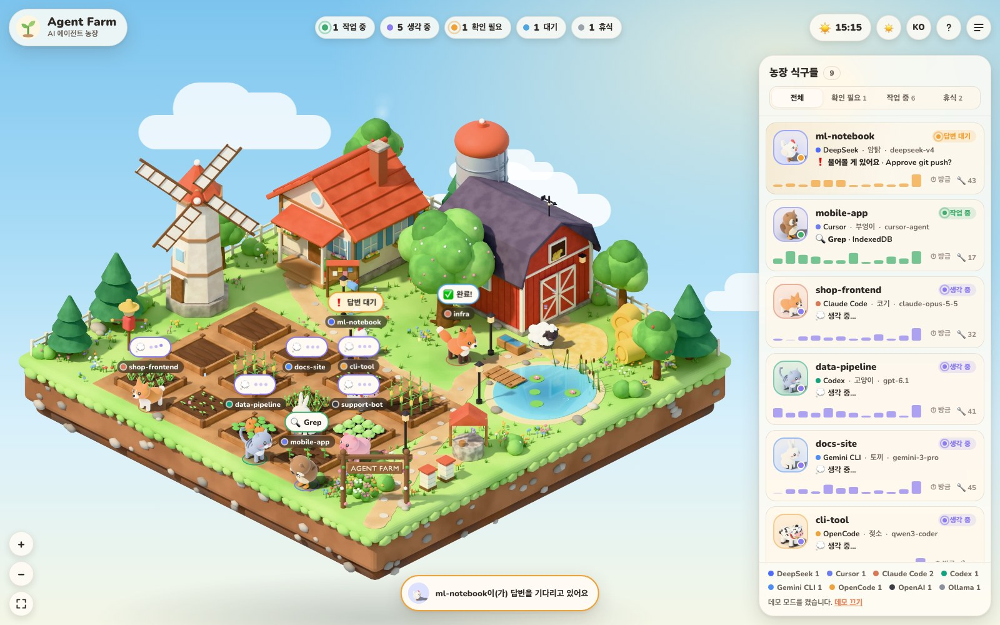
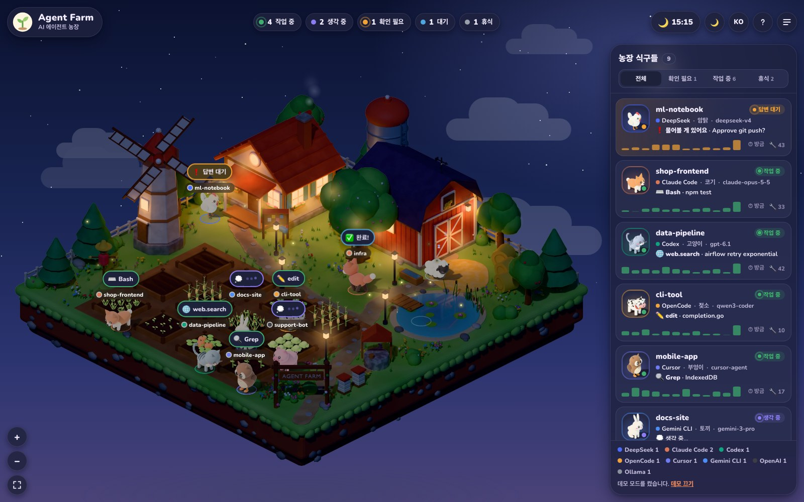

# 🌾 Agent Farm

[English](README.md) · [繁體中文](README.zh-TW.md) · [简体中文](README.zh-CN.md) · [Français](README.fr.md) · [Español](README.es.md) · [日本語](README.ja.md) · **한국어**

**Blender로 렌더링한** 2.5D 아이소메트릭 농장입니다. 컴퓨터에 있는 모든 AI 에이전트가 농장 동물이 됩니다. 누가 일하고 있는지, 누가 생각 중인지, 누가 당신의 답변을 기다리는지 한눈에 알 수 있습니다.



- **다양한 플랫폼 지원**: Claude Code, OpenAI Codex, Cursor, Gemini CLI, Google Antigravity, OpenCode, Ollama는 자동으로 감지되며, 그 밖의 것도 HTTP 요청 한 번이면 참여할 수 있습니다.
- **에이전트마다 동물 한 마리**: 여우, 고양이, 토끼, 부엉이, 젖소, 돼지, 양, 암탉, 오리, 코기, 염소, 조랑말. 같은 세션은 항상 같은 동물입니다.
- **설치할 것이 없음**: `npm install`도 Blender도 필요 없습니다. 그림은 이미 렌더링되어 저장소에 들어 있습니다.
- **내 컴퓨터 안에서만 동작**: 로컬 세션 기록만 읽으며 아무것도 업로드하지 않습니다.
- 낮/밤, 30개 언어(시스템 언어를 자동으로 따릅니다), 모바일 레이아웃, 에이전트가 나를 필요로 할 때 데스크톱 알림.

## 다운로드

| 빌드 | 다운로드 |
| --- | --- |
| Apple Silicon (M 시리즈) | [AgentFarm-1.1.3-macOS-AppleSilicon.dmg](https://github.com/irons163/agent-farm/releases/latest/download/AgentFarm-1.1.3-macOS-AppleSilicon.dmg) |
| Intel | [AgentFarm-1.1.3-macOS-Intel.dmg](https://github.com/irons163/agent-farm/releases/latest/download/AgentFarm-1.1.3-macOS-Intel.dmg) |
| Windows 10/11 (64비트) | [AgentFarm-1.1.3-Windows-x64-setup.exe](https://github.com/irons163/agent-farm/releases/latest/download/AgentFarm-1.1.3-Windows-x64-setup.exe) |
| Linux (x64: `.AppImage` 또는 `.deb`, arm64: `.AppImage`) | [최신 릴리스](https://github.com/irons163/agent-farm/releases/latest) |

DMG를 열고 Agent Farm을 응용 프로그램 폴더로 끌어다 놓으면 끝입니다. Node.js를 설치할 필요도, 터미널을 열 필요도 없습니다.

앱은 백그라운드에서 서버를 실행하고 창을 엽니다. 창을 닫아도 메뉴 막대(오른쪽 위 아이콘)에서 계속 실행되며, 에이전트가 확인을 필요로 하면 기본 알림이 표시됩니다.

**Windows / Linux:** 사용법은 같고, 메뉴 막대 대신 시스템 트레이에 아이콘이 나타납니다. Windows 설치 프로그램은 아직 코드 서명이 되어 있지 않아 SmartScreen이 «Windows의 PC 보호» 화면을 표시합니다. **추가 정보 → 실행**을 클릭하세요. Linux에서는 AppImage에 실행 권한(`chmod +x`)을 주거나 `.deb`를 설치하세요. GNOME에는 기본 트레이가 없으므로 아이콘을 보려면 AppIndicator 확장 프로그램을 설치해야 합니다(없다면 앱을 다시 실행하면 창이 다시 나타납니다).

소스에서 직접 실행할 수도 있습니다:

## 빠른 시작

[Node.js](https://nodejs.org) 20 이상이 필요합니다(OpenCode를 보려면 22.13 이상).

```bash
git clone https://github.com/irons163/agent-farm.git
cd agent-farm
npm start
```

<http://127.0.0.1:5180>을 여세요. 최근 12시간 안에 사용한 에이전트가 저절로 나타납니다.

아직 실행 중인 에이전트가 없나요? 데모를 먼저 보세요:

```bash
npm run demo
```

## 동물들의 의미

| 상태 | 동물 |
| --- | --- |
| 🌱 작업 중 | 자기 밭을 가꿉니다. 도구를 많이 쓸수록 작물이 커집니다 |
| 💭 생각 중 | 생각 풍선을 띄운 채 밭 옆에 서 있습니다 |
| ❗ 확인 필요 | 농가 현관에서 기다리고(승인 또는 질문) 알림을 보냅니다 |
| ⚠️ 오류 | 작은 먹구름이 생깁니다 |
| ✅ 대기 | 풀밭을 산책합니다 |
| 💤 휴식 | 15분 동안 아무 일도 없으면 헛간 옆에서 낮잠을 잡니다 |

풍차와 굴뚝 연기는 바쁜 에이전트가 많을수록 빨라집니다. 농장에는 최대 12마리가 살고, 나머지는 사이드 패널에 목록으로 나옵니다. 스크롤로 확대/축소, 드래그로 이동하고, 동물을 클릭하면 최근에 한 일을 볼 수 있습니다.



## 지원 플랫폼

| 플랫폼 | 읽는 위치(읽기 전용) | 상태 |
| --- | --- | --- |
| Claude Code | `~/.claude/projects/` (또는 `CLAUDE_CONFIG_DIR`) | ✅ 테스트 완료 |
| OpenAI Codex (CLI / 데스크톱) | `~/.codex/sessions/` (또는 `CODEX_HOME`) | ✅ 테스트 완료 |
| Cursor Agent | `~/.cursor/projects/*/agent-transcripts/` | ✅ 테스트 완료 |
| Google Antigravity | `~/.gemini/antigravity/` | ✅ 테스트 완료 |
| OpenCode | `~/.local/share/opencode/opencode.db` | ✅ 테스트 완료 |
| Gemini CLI | `~/.gemini/tmp/*/chats/` | ⚠️ 로그 형식을 바탕으로 구현, 아직 테스트 전 |
| Ollama | `http://127.0.0.1:11434/api/ps` (또는 `OLLAMA_HOST`) | ⚠️ 아직 테스트 전 |
| 그 밖의 모든 것 | `POST /api/report`, 아래 참고 | ✅ |

개발과 테스트는 macOS에서 했습니다. Linux와 Windows 경로도 처리해 두었지만 아직 써 보지는 못했습니다. 이슈를 환영합니다.

### 다른 AI도 농장에 초대하기

OpenAI Agents SDK, LangGraph, AutoGen, DeepSeek, 직접 만든 봇… 무엇이든 자신의 상태를 보고할 수 있습니다:

```bash
curl -X POST http://127.0.0.1:5180/api/report -H 'content-type: application/json' \
  -d '{"id":"support-bot","platform":"openai","status":"working","tool":"search","detail":"order #1932"}'
```

```bash
node bin/farm-report.mjs --id researcher --platform deepseek --status thinking
```

```python
import requests
requests.post("http://127.0.0.1:5180/api/report", json={
    "id": "researcher", "platform": "deepseek", "status": "working", "tool": "web_search"})
```

`status`는 `working`, `thinking`, `waiting`, `error`, `idle`, `sleeping` 중 하나이며, 에이전트를 내보내려면 `offline`을 보냅니다. 선택 항목: `name`, `model`, `project`, `task`, `detail`, `tokens`, `animal`(동물 지정), `color`(`#RRGGBB`).

### Claude Code 실시간 훅(선택)

상태는 이미 대화 기록에서 파악됩니다. 훅을 추가하면 «승인 대기» 같은 상태가 즉시 정확하게 표시됩니다. «?» 대화상자에는 올바른 경로가 채워진 `~/.claude/settings.json`용 블록이 있어 그대로 붙여 넣을 수 있습니다.

## 설정

| 플래그 | 환경 변수 | 기본값 | 설명 |
| --- | --- | --- | --- |
| `--port 5181` | `PORT` | `5180` | 포트 |
| `--demo` | `FARM_DEMO=on` | `off` | 데모 동물 표시 |
| `--host 0.0.0.0` | `HOST` | `127.0.0.1` | 다른 기기에 공개(토큰 필요, 보안 항목 참고) |
| `--token …` | `FARM_TOKEN` | 없음 | 접근 토큰 |
| | `FARM_WINDOW_HOURS` | `12` | 이 시간보다 오래 활동이 없는 세션은 숨김 |
| | `FARM_SLEEP_MIN` | `15` | 동물이 잠들기까지 아무 일도 없는 시간(분) |
| | `FARM_ONESHOT_MIN` | `30` | 끝난 일회성 세션이 남아 있는 시간(분) |
| | `FARM_COLLECTORS` | 전체 | 일부 플랫폼만 사용. 예: `claude-code,codex` |

플래그는 `--` 뒤에 붙입니다. 예: `npm start -- --port 5181` (Windows에서도 동작합니다).

**임시 세션**: 임시 폴더(`/tmp`, `/var/folders`)에서 실행된 세션이나 일회성 세션(질문 한 번, 도구 없음)에는 «임시» 표시가 붙고 맨 뒤에 나열되어, 진짜 에이전트의 동물과 밭을 빼앗지 않습니다. 숨기려면 «?» → 임시 세션 → 숨기기.

## 보안과 개인정보

농장 화면에는 프롬프트 일부, 프로젝트 경로, 세션 ID가 표시되므로 다음과 같이 동작합니다:

- `127.0.0.1`에서만 수신하며 루프백 호스트 이름만 허용합니다(DNS 리바인딩 차단). 브라우저에서 오는 쓰기 요청은 농장 자신의 페이지에서 온 것이어야 하므로, 다른 웹사이트나 로컬의 다른 페이지는 아무것도 바꿀 수 없습니다.
- 각 플랫폼의 로그는 읽기만 하며, 쓰거나 업로드하지 않습니다. 외부로 나가는 요청은 Google Fonts뿐입니다. 앱은 스스로 업데이트를 확인하지도 않습니다. 도움말 패널이나 트레이 메뉴의 «업데이트 확인»으로 릴리스 페이지를 여세요.
- 휴대폰이나 다른 컴퓨터에서 보려면 반드시 토큰을 설정해야 하며, 설정하지 않으면 서버가 시작되지 않습니다:

  ```bash
  npm start -- --host 0.0.0.0 --token 긴-무작위-문자열
  ```

  각 기기에서 `http://<이 컴퓨터의 IP>:5180/?token=<토큰>`을 한 번 열면 쿠키가 기억합니다. `farm-report`와 Claude Code 훅은 환경 변수 `FARM_TOKEN`을 읽습니다. 토큰은 암호화되지 않은 HTTP로 전송되므로 신뢰할 수 있는 네트워크에서만 사용하세요.

## 문제 해결

- **`Port 5180 is already in use`**: 농장이 이미 실행 중이거나, 다른 포트를 지정하세요: `npm start -- --port 5181`.
- **내 에이전트가 보이지 않음**: «?» 대화상자에 감지된 플랫폼이 표시됩니다. 12시간 넘게 활동이 없는 세션은 숨겨집니다.
- **OpenCode가 더 새로운 Node가 필요하다고 함**: OpenCode의 데이터베이스를 읽으려면 Node.js 22.13 이상이 필요합니다.

## 라이선스

[MIT](LICENSE)
