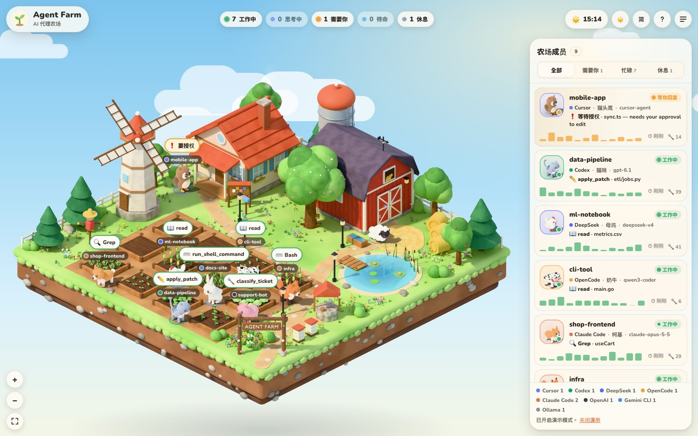
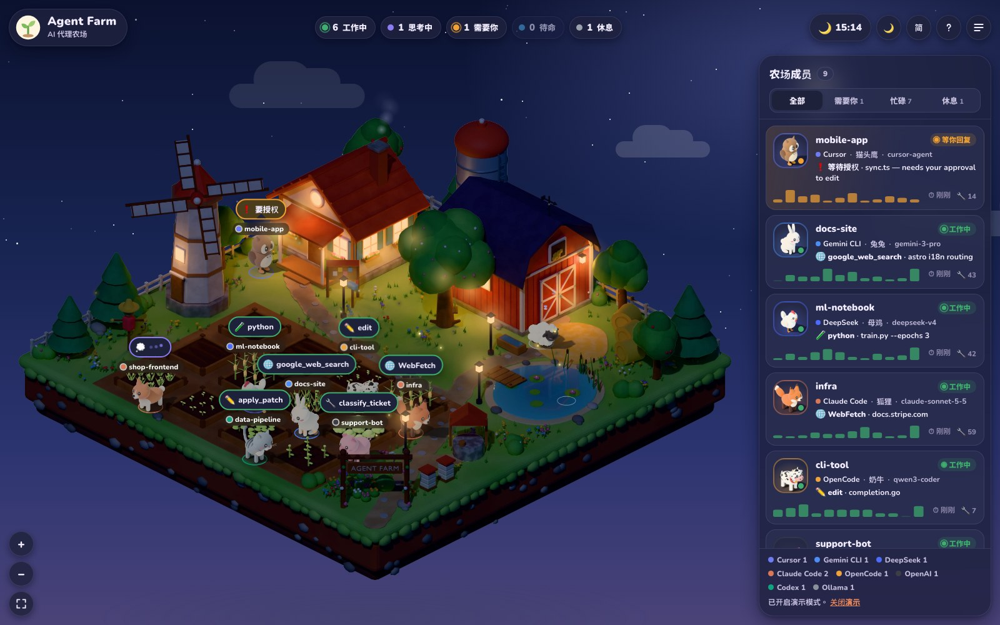

# 🌾 Agent Farm · AI 代理农场

[English](README.md) · [繁體中文](README.zh-TW.md) · **简体中文** · [Français](README.fr.md) · [Español](README.es.md) · [日本語](README.ja.md) · [한국어](README.ko.md)

一座用 **Blender 渲染**的 2.5D 等距农场：电脑上每个 AI agent 都是一只农场动物。谁在工作、谁在思考、谁在等你回复，一眼就能看出来。



- **支持多平台**：Claude Code、OpenAI Codex、Cursor、Gemini CLI、Google Antigravity、OpenCode、Ollama 会自动检测；其他任何程序用一行 HTTP 请求就能加入。
- **每个 agent 一种动物**：狐狸、猫、兔子、猫头鹰、奶牛、猪、绵羊、母鸡、鸭子、柯基、山羊、小马，同一个会话始终是同一只。
- **零安装**：不用 `npm install`、不用 Blender，美术图已经渲染好放在仓库里。
- **只在你的电脑上运行**：只读各平台的本机记录，不上传任何东西。
- 白天／夜晚、30 种语言（自动跟随系统语言）、手机版、需要你回复时弹出桌面通知。

## 下载

| 版本 | 下载 |
| --- | --- |
| Apple Silicon（M 系列） | [AgentFarm-1.1.3-macOS-AppleSilicon.dmg](https://github.com/irons163/agent-farm/releases/latest/download/AgentFarm-1.1.3-macOS-AppleSilicon.dmg) |
| Intel | [AgentFarm-1.1.3-macOS-Intel.dmg](https://github.com/irons163/agent-farm/releases/latest/download/AgentFarm-1.1.3-macOS-Intel.dmg) |
| Windows 10/11（64 位） | [AgentFarm-1.1.3-Windows-x64-setup.exe](https://github.com/irons163/agent-farm/releases/latest/download/AgentFarm-1.1.3-Windows-x64-setup.exe) |
| Linux（x64：`.AppImage` 或 `.deb`；arm64：`.AppImage`） | [最新发行版](https://github.com/irons163/agent-farm/releases/latest) |

打开 DMG，把 Agent Farm 拖进“应用程序”，就这样。不用安装 Node.js，也不用打开终端。

App 会自动在后台运行服务器并打开窗口。关掉窗口后会继续留在菜单栏（右上角图标）；有 agent 在等你回复时会弹出原生通知。

**Windows / Linux：** 用法相同，只是常驻在系统托盘而不是菜单栏。Windows 安装包目前还没有代码签名，SmartScreen 会显示“Windows 已保护你的电脑”，请点击**更多信息 → 仍要运行**。Linux 的 AppImage 需要先 `chmod +x`，或者直接安装 `.deb`。GNOME 默认没有系统托盘，需要安装 AppIndicator 扩展才能看到图标（没装的话，再打开一次 App 就能把窗口叫回来）。

也可以从源码运行：

## 快速开始

需要 [Node.js](https://nodejs.org) 20 或更高版本（要看 OpenCode 的话需要 22.13 以上）。

```bash
git clone https://github.com/irons163/agent-farm.git
cd agent-farm
npm start
```

打开 <http://127.0.0.1:5180>。电脑上最近 12 小时用过的 agent 会自己出现。

还没有 agent 在运行也没关系，可以先看演示：

```bash
npm run demo
```

## 动物在做什么

| 状态 | 动物 |
| --- | --- |
| 🌱 工作中 | 在自己的菜圃里干活，工具用得越多，作物长得越大 |
| 💭 思考中 | 站在菜圃旁，头上冒出思考泡泡 |
| ❗ 等你回复 | 跑到农舍门廊等你（要授权、有问题要问），并弹出通知 |
| ⚠️ 出错 | 头上有乌云闪电 |
| ✅ 待命 | 在草地上散步 |
| 💤 休息 | 闲置 15 分钟后回到谷仓旁睡觉 |

风车转速和烟囱的烟会随工作中的 agent 数量变化。农场上最多 12 只，其他的列在右侧列表里。滚轮缩放、拖动移动，点击动物可以看它最近做了什么。



## 支持的平台

| 平台 | 从哪里读取（只读） | 状态 |
| --- | --- | --- |
| Claude Code | `~/.claude/projects/`（或 `CLAUDE_CONFIG_DIR`） | ✅ 已实测 |
| OpenAI Codex（CLI／桌面版） | `~/.codex/sessions/`（或 `CODEX_HOME`） | ✅ 已实测 |
| Cursor Agent | `~/.cursor/projects/*/agent-transcripts/` | ✅ 已实测 |
| Google Antigravity | `~/.gemini/antigravity/` | ✅ 已实测 |
| OpenCode | `~/.local/share/opencode/opencode.db` | ✅ 已实测 |
| Gemini CLI | `~/.gemini/tmp/*/chats/` | ⚠️ 按日志格式实现，尚未实测 |
| Ollama | `http://127.0.0.1:11434/api/ps`（或 `OLLAMA_HOST`） | ⚠️ 尚未实测 |
| 任何其他程序 | `POST /api/report`，见下面 | ✅ |

在 macOS 上开发和测试；Linux 和 Windows 的路径都已处理，但还没有实际测试过，有问题欢迎提 issue。

### 让其他 AI 也上农场

OpenAI Agents SDK、LangGraph、AutoGen、DeepSeek、你自己的机器人……任何程序都能汇报状态：

```bash
curl -X POST http://127.0.0.1:5180/api/report -H 'content-type: application/json' \
  -d '{"id":"support-bot","platform":"openai","status":"working","tool":"search","detail":"order #1932"}'
```

```bash
node bin/farm-report.mjs --id researcher --platform deepseek --status thinking
```

```python
import requests
requests.post("http://127.0.0.1:5180/api/report", json={
    "id": "researcher", "platform": "deepseek", "status": "working", "tool": "web_search"})
```

`status` 可以是 `working`、`thinking`、`waiting`、`error`、`idle`、`sleeping`，或用 `offline` 让它离开。其他可选字段：`name`、`model`、`project`、`task`、`detail`、`tokens`、`animal`（指定动物）、`color`（`#RRGGBB`）。

### Claude Code 实时钩子（可选）

不加也能用：状态是从对话记录判断的。加上 hooks 之后，“等待授权”这类状态会实时、准确地显示。网页右上角“?”里有一段已经填好路径的配置，粘贴进 `~/.claude/settings.json` 就行。

## 设置

| 参数 | 环境变量 | 默认值 | 说明 |
| --- | --- | --- | --- |
| `--port 5181` | `PORT` | `5180` | 端口 |
| `--demo` | `FARM_DEMO=on` | `off` | 显示演示动物 |
| `--host 0.0.0.0` | `HOST` | `127.0.0.1` | 开放给其他设备，需要配合令牌，见“安全与隐私” |
| `--token …` | `FARM_TOKEN` | 无 | 访问令牌 |
| | `FARM_WINDOW_HOURS` | `12` | 超过多少小时没动作就不显示 |
| | `FARM_SLEEP_MIN` | `15` | 闲置多少分钟后去睡觉 |
| | `FARM_ONESHOT_MIN` | `30` | 一次性会话结束后多少分钟消失 |
| | `FARM_COLLECTORS` | 全部 | 只启用部分平台，例如 `claude-code,codex` |

参数要加在 `--` 后面，例如 `npm start -- --port 5181`，在 Windows 上也能用。

**临时会话**：在临时文件夹（`/tmp`、`/var/folders`）里运行的，或只问一句、没用任何工具的一次性会话，会标上“临时”并排在最后，不会抢真实 agent 的动物和菜圃。要完全隐藏：右上角“?”→“临时会话”→ 隐藏。

## 安全与隐私

农场界面会显示你的提示词片段、项目路径和会话 ID，所以：

- 默认只监听 `127.0.0.1`，而且只接受 `localhost`、`127.0.0.1` 这类主机名（防 DNS rebinding）。浏览器发来的写入请求必须来自农场自己的地址，其他网站和本机其他网页都改不了。
- 各平台的记录只读不写，不会上传到任何地方。唯一会联网的是 Google Fonts 字体。App 也不会自己检查更新；想知道有没有新版本，请从帮助面板或托盘菜单里的“检查更新”打开发布页面。
- 想在手机或局域网里的其他电脑上看，必须设置令牌，否则服务器不会启动：

  ```bash
  npm start -- --host 0.0.0.0 --token 换成一串很长的随机字符
  ```

  每台设备第一次打开 `http://<这台电脑的 IP>:5180/?token=<令牌>`，之后会用 cookie 记住。`farm-report` 和 Claude Code hook 会读取环境变量 `FARM_TOKEN`。令牌走的是明文 HTTP，只在可信的网络里这样用。

## 常见问题

- **`Port 5180 is already in use`**：农场可能已经在运行了；或者换一个端口：`npm start -- --port 5181`。
- **看不到我的 agent**：右上角“?”会列出每个平台有没有检测到。超过 12 小时没动作的会话不会显示。
- **OpenCode 提示需要更新 Node**：读取 OpenCode 的数据库需要 Node.js 22.13 以上。

## 许可证

[MIT](LICENSE)
